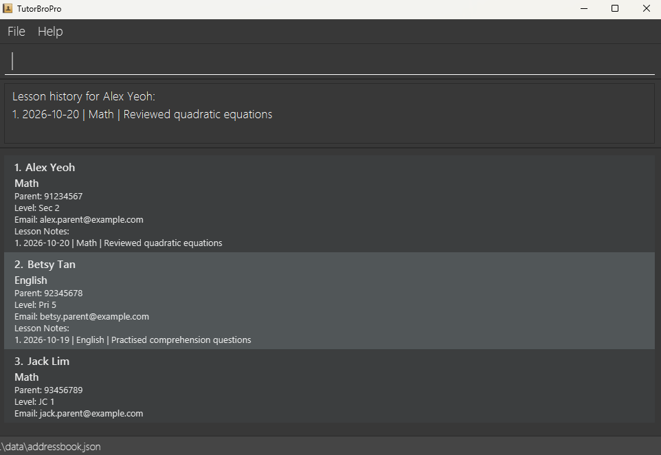

# TutorBroPro User Guide

TutorBroPro is a **desktop application for tutors to manage student profiles and lesson records**, optimized for use through a Command Line Interface (CLI) while retaining the benefits of a Graphical User Interface (GUI).

<!-- * Table of Contents -->
<page-nav-print />

--------------------------------------------------------------------------------------------------------------------

## Quick start

1. Ensure that Java `25` or later is installed on your computer.<br>
   **Mac users:** Ensure you have the precise JDK version prescribed [here](https://se-education.org/guides/tutorials/javaInstallationMac.html).

1. Download the latest `.jar` file from [here](https://github.com/se-edu/addressbook-level3/releases).

1. Copy the file to the folder you want to use as the _home folder_ for your AddressBook.

1. Open a terminal, `cd` to the folder containing the JAR file, and run `java -jar addressbook.jar`.<br>
   A GUI similar to the one below should appear in a few seconds. Note how the app contains some sample data.<br>
   

1. Type a command in the command box and press Enter to execute it. For example, type **`help`** and press Enter to open the help window.<br>
   Some example commands you can try:

   * `list` : Lists all students.

   * `addstudent n/John Doe lvl/Sec 2 s/Math pn/91234567 pe/johnd@example.com` : Adds a student named `John Doe`.

   * `view 1` : Shows the full profile of the 1st student shown in the current list.

   * `addnote 1 d/2026-10-01 s/Math note/Revised simultaneous equations.` : Adds a lesson note.

   * `history 1` : Shows the lesson history of the 1st student shown in the current list.

   * `deletestudent 3` : Deletes the 3rd student shown in the current list.

   * `deletenote 1 ln/2` : Deletes the 2nd lesson note of the 1st student.

   * `exit` : Exits the app.

1. Refer to the [Features](#features) section below for details of each command.

--------------------------------------------------------------------------------------------------------------------

## Features

<box type="info" seamless>

**Notes about the command format:**<br>

* Words in `UPPER_CASE` are the parameters to be supplied by the user.<br>
  For example, in `addstudent n/NAME`, replace `NAME` with a value such as `John Doe`.

* Items followed by `...` can appear zero or more times.<br>
  For example, `s/SUBJECT...` may be written as `s/Math` or `s/Math s/Science`.

* Parameters can be in any order where the command supports multiple prefixed fields.<br>
  For example, `pn/PARENT_PHONE pe/PARENT_EMAIL n/NAME` is also acceptable for `addstudent`.

* If you are using a PDF version of this document, be careful when copying and pasting commands that span multiple lines as space characters surrounding line-breaks may be omitted when copied over to the application.
</box>

### Adding a student: `addstudent`

Adds a student profile with the student's name, academic level, subjects, and parent contact details.

Format: `addstudent n/NAME lvl/LEVEL s/SUBJECT... pn/PARENT_PHONE pe/PARENT_EMAIL`

* `NAME`, `LEVEL`, at least one `SUBJECT`, `PARENT_PHONE`, and `PARENT_EMAIL` are compulsory.
* Duplicate subjects are merged.
* Duplicate students are not allowed. A student is considered a duplicate only when both the name and parent phone number match an existing student.
* `PARENT_PHONE` must contain exactly 8 digits and start with `8` or `9`.

Example:
* `addstudent n/John Doe lvl/Sec 2 s/Math s/Science pn/91234567 pe/johnd@example.com`

### Viewing a student's profile: `view`

Shows the full profile of a student, including their academic level, subjects, parent contact details, and number of recorded lessons.

Format: `view INDEX`

* `INDEX` refers to the student number shown in the displayed student list and must be a positive integer.

Example:
* `view 1` shows the full profile of the 1st student.

### Finding students: `find`

Searches all students by name and displays the matches with new index numbers.

Format: `find KEYWORD [MORE_KEYWORDS]...`

* Matching is case-insensitive and includes students whose names contain any of the keywords as whole words.
* If there are no matches, the previous student list stays displayed, so its index numbers remain usable.
* Use `list` to display all students again.

Example:
* `find Alex`

### Adding a lesson note: `addnote`

Adds a lesson note to an existing student in the address book.

Format: `addnote INDEX d/DATE s/SUBJECT note/NOTE_TEXT`

* Adds the lesson note to the student at the specified `INDEX`. The index refers to the index number shown in the displayed student list. The index **must be a positive integer** 1, 2, 3, ...
* All three of `d/`, `s/` and `note/` are compulsory.
* `DATE` must be in `YYYY-MM-DD` format and cannot be a future date.
* `NOTE_TEXT` cannot be blank, must not exceed 500 characters, and must be on a single line.
* A student cannot have two lesson notes with the same date, subject and note text.
* Lesson notes are kept sorted from the most recent date to the earliest.

Examples:
* `addnote 1 d/2026-10-01 s/Math note/Revised simultaneous equations.`
* `addnote 2 d/2026-09-20 s/Science note/Covered photosynthesis, needs more practice on diagrams.`

### Viewing lesson history: `history`

Shows all lesson notes recorded for a student, from the most recent date to the earliest.

Format: `history INDEX`

* Shows the lesson notes of the student at the specified `INDEX`. The index refers to the index number shown in the displayed student list. The index **must be a positive integer** 1, 2, 3, ...
* Each note is numbered. That number is the `LESSON_INDEX` used by the `deletenote` command.
* If the student has no lesson notes, a message saying so is shown instead.

Example:
* `history 1` shows the lesson history of the 1st student, for example:

```
Lesson history for John Doe:
1. 2026-10-01 | Math | Revised simultaneous equations.
2. 2026-09-20 | Science | Covered photosynthesis.
```

### Deleting a lesson note: `deletenote`

Deletes one lesson note from an existing student in the address book.

Format: `deletenote INDEX ln/LESSON_INDEX`

* Deletes a lesson note from the student at the specified `INDEX`. The index refers to the index number shown in the displayed student list.
* `LESSON_INDEX` refers to the number shown next to the note in the output of `history INDEX`.
* Both indexes **must be positive integers** 1, 2, 3, ...
* Remaining lesson notes are renumbered, so run `history` again before deleting another note.

Examples:
* `deletenote 1 ln/2` deletes the 2nd lesson note of the 1st student.
* `deletenote 3 ln/1` deletes the most recent lesson note of the 3rd student.

### Deleting a student: `deletestudent`

Deletes the specified student and all their associated lesson notes from the address book.

Format: `deletestudent INDEX`

* Deletes the student at the specified `INDEX`.
* The index refers to the index number shown in the displayed student list.
* The index **must be a positive integer** 1, 2, 3, ...

Examples:
* `deletestudent 2` deletes the 2nd student in the displayed student list.

The success message reports the student name and the number of lesson notes removed, for example:
`Deleted student: Alex Yeoh, and their 3 lesson note(s).`
A student with no notes can also be deleted; the reported count is `0`.

Deletion is immediate, without a confirmation prompt, and cannot be undone. Other students and their notes remain unchanged.

### Saving the data

AddressBook automatically saves data after every command. You do not need to save manually.

### Editing the data file

AddressBook data is saved automatically as a JSON file `[JAR file location]/data/addressbook.json`. Advanced users are welcome to update data directly by editing that data file.

<box type="warning" seamless>

**Caution:**
If your changes make the data file invalid, AddressBook starts with an empty address book at the next run. The invalid file remains on disk until you run a command (AddressBook saves after every command). Still, we recommend backing up the file before editing it.<br>
Furthermore, certain edits can cause the AddressBook to behave in unexpected ways (e.g., if a value entered is outside of the acceptable range). Therefore, edit the data file only if you are confident that you can update it correctly.
</box>

--------------------------------------------------------------------------------------------------------------------

## FAQ

**Q**: How do I transfer my data to another computer?<br>
**A**: Install the app on the other computer and overwrite the data file it creates with the data file from your previous AddressBook home folder.

--------------------------------------------------------------------------------------------------------------------

## Known issues

1. **When using multiple screens**, if you move the application to a secondary screen, and later switch to using only the primary screen, the GUI will open off-screen. The remedy is to delete the `preferences.json` file created by the application before running the application again.
2. **If you minimize the Help Window** and then run the `help` command (or use the `Help` menu, or the keyboard shortcut `F1`) again, the original Help Window will remain minimized, and no new Help Window will appear. The remedy is to manually restore the minimized Help Window.

--------------------------------------------------------------------------------------------------------------------

## Command summary

Action     | Format, Examples
-----------|----------------------------------------------------------------------------------------------------------------------------------------------------------------------
**Add student** | `addstudent n/NAME lvl/LEVEL s/SUBJECT... pn/PARENT_PHONE pe/PARENT_EMAIL`<br> e.g., `addstudent n/James Ho lvl/Sec 2 s/Math s/Science pn/91234567 pe/jamesho@example.com`
**View profile** | `view INDEX`<br> e.g., `view 1`
**Delete student** | `deletestudent INDEX`<br> e.g., `deletestudent 3`
**Add lesson note** | `addnote INDEX d/DATE s/SUBJECT note/NOTE_TEXT`<br> e.g., `addnote 1 d/2026-10-01 s/Math note/Revised simultaneous equations.`
**View lesson history** | `history INDEX`<br> e.g., `history 1`
**Delete lesson note** | `deletenote INDEX ln/LESSON_INDEX`<br> e.g., `deletenote 1 ln/2`
